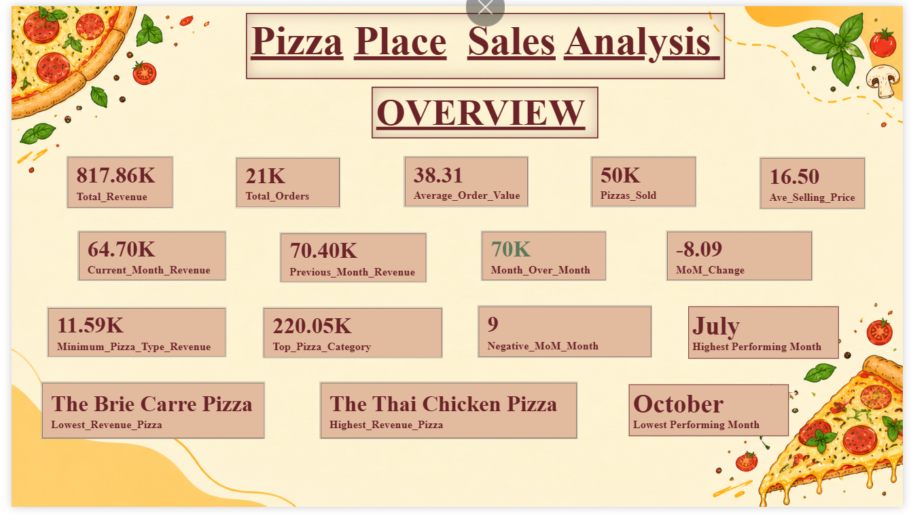
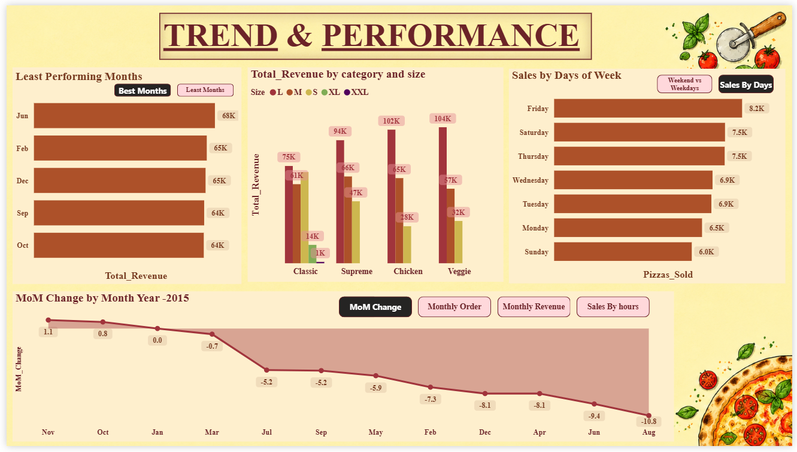
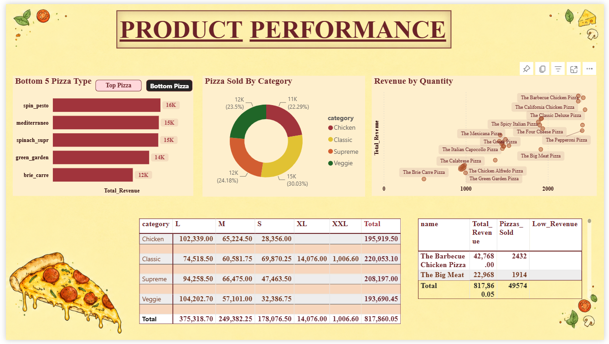
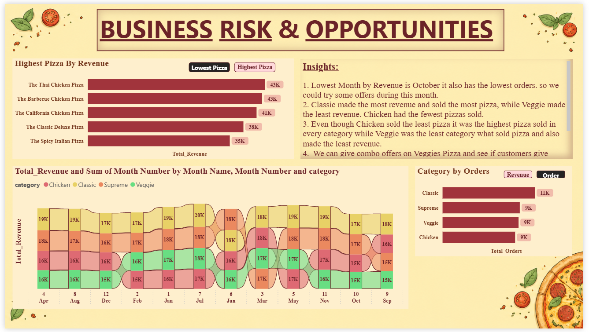

# 🍕 Pizza Place Sales Analysis | Python, SQL Server & Power BI

An end-to-end data analytics project that analyzes pizza sales data from 2015 to identify revenue trends, top- and low-performing pizzas, and category-level sales performance. The project uses Python for data cleaning and exploratory analysis, SQL Server for querying and validation, and Power BI to build an interactive sales dashboard.

---

## Table of Contents

- [About the Project](#about-the-project)
- [Technologies Used](#technologies-used)
- [Dataset](#dataset)
- [Project Features](#project-features)
- [Power BI Dashboard](#power-bi-dashboard)
- [Key Findings](#key-findings)
- [Business Recommendations](#business-recommendations)
- [How to Run](#how-to-run)
- [Project Structure](#project-structure)
- [Future Improvements](#future-improvements)
- [Author](#author)

---

## About the Project

The objective of this project is to understand pizza sales performance by analyzing order volume, revenue, product categories, pizza types, and monthly sales patterns.

The analysis follows an end-to-end workflow, starting with data quality checks and exploratory analysis in Python, followed by SQL-based analysis in SQL Server and dashboard development in Power BI.

The findings are used to identify sales patterns, highlight underperforming products, and suggest potential business improvements.

---

## Technologies Used

- **Python 3.x**
- **Pandas** — data manipulation and analysis
- **SQL Server** — data validation and SQL analysis
- **Power BI Desktop** — dashboard development and visualization
- **DAX** — calculated measures and KPIs
- **Jupyter Notebook** — Python analysis

---

## Dataset

The project uses the Pizza Place Sales Analysis dataset from Kaggle.

**Dataset details:**
- Approximately 48,620 order-detail records
- Sales data covering January–December 2015
- Four datasets: Orders, Order Details, Pizzas, and Pizza Types

**Dataset source:** [Pizza Place Sales Analysis — Kaggle](https://www.kaggle.com/datasets/ankitrajmishra/pizza-place-sales-analysis)

---

## Project Features

- Data quality checks for missing values, duplicate records, data types, and relationships between datasets.
- Revenue and quantity calculations using Python and SQL.
- Sales comparisons across pizza categories, sizes, and individual pizza types.
- Monthly revenue analysis to identify high- and low-performing periods.
- KPI calculations, including total revenue, total orders, pizzas sold, and average order value.
- Month-over-month revenue analysis using DAX.
- Interactive visual reporting through Power BI charts, tables, and KPI cards.

---

## Power BI Dashboard

The dashboard contains four pages, each focusing on a different aspect of sales performance.

### 1. Overview

Provides a summary of overall sales performance using key metrics and high-level comparisons.



### 2. Trend & Performance

Explores monthly revenue trends, month-over-month changes, sales by day type, and category-level performance.



### 3. Product Performance

Compares top- and bottom-performing pizzas, category and size combinations, and the relationship between revenue and quantity sold.



### 4. Business Risks & Opportunities

Highlights category and product performance patterns, monthly category trends, and potential areas for sales improvement.



---

## Key Findings

- **Total Revenue:** $817,860.05
- **Total Orders:** 21,350
- **Total Pizzas Sold:** 49,574
- **Average Order Value:** $38.31
- **Highest-Revenue Category:** Classic — $220,053.10
- **Lowest-Revenue Month:** October — $64,027.60
- **Highest-Revenue Pizza:** Thai Chicken Pizza — $43,434.25
- **Lowest-Revenue Pizza:** The Brie Carre Pizza — $11,588.50

---

## Business Recommendations

- Consider targeted promotions during slower sales periods and measure their impact on revenue and order volume.
- Review lower-revenue pizza types to identify opportunities for promotion or menu improvements.
- Test offers on the Veggie category and compare performance before and after the promotion.
- Monitor monthly and category-level trends to support future sales and inventory planning.

These recommendations are based on observed sales patterns; promotional results have not been tested in this project.

---

## How to Run

### 1. Clone or Download the Repository

Download the project files or clone the repository:

```bash
git clone YOUR_GITHUB_REPOSITORY_URL
```

### 2. Install Python Libraries

Install the libraries required for the Python analysis:

```bash
pip install pandas numpy matplotlib seaborn jupyter
```

Only install the libraries actually used in your notebook.

### 3. Run the Python Analysis

Open the Jupyter Notebook and run the cells to explore the data and reproduce the analysis.

### 4. Run the SQL Analysis

Open the SQL scripts in SQL Server Management Studio (SSMS), connect to SQL Server, and execute the queries against the imported project database.

### 5. Open the Power BI Dashboard

Open the `.pbix` file in Power BI Desktop to explore the report and interact with its visuals.

---

## Project Structure

```text
Pizza-Place-Sales-Analysis/
│
├── README.md
├── screenshots/
│   ├── overview.png
│   ├── trend-performance.png
│   ├── product-performance.png
│   └── business-risks-opportunities.png
│
├── python/
│   └── pizza_sales_analysis.ipynb
│
├── sql/
│   └── pizza_sales_analysis.sql
│
└── powerbi/
    └── pizza_sales_dashboard.pbix
```

*Update the filenames and folders to match the files you actually upload.*

---

## Future Improvements

- Analyze additional years of sales data to compare year-over-year performance.
- Incorporate cost data to evaluate profit and profit margins.
- Use customer-level data, if available, to investigate repeat purchases and customer retention.
- Evaluate the impact of promotions using sales data collected before and after implementation.

---

## Author

**Aakanksha Haravde**

Aspiring Data Analyst | Python | SQL Server | Power BI

